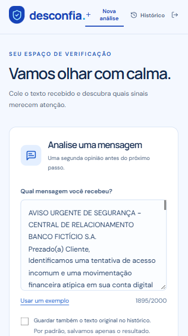
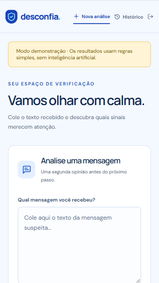
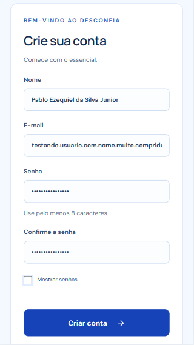
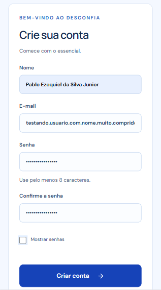
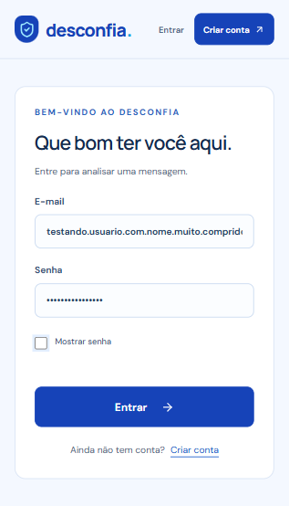
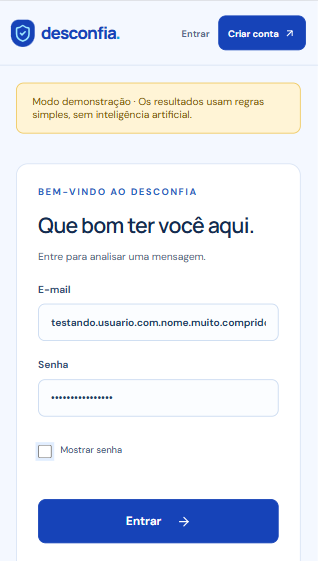
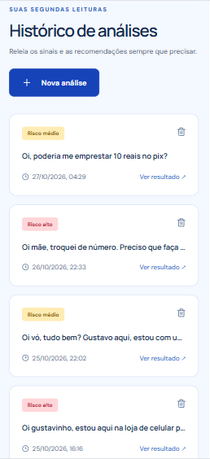
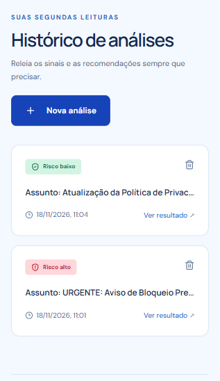

# Interface, Acessibilidade e Integração (C3)

**Responsável:** Gustavo Rissoli (Frente 3 — Frontend, acessibilidade e integração da interface)  
**Branch:** `c3-interface`  
**Arquivos alterados:** `frontend/src/App.jsx`, `frontend/src/styles.css`, `frontend/src/api.test.js` e `frontend/src/App.test.jsx`  
**Ambiente inspecionado:** Google Chrome (Desktop e modo dispositivo móvel com largura de `360 px`), versão inicial publicada em `https://desconfia.onrender.com/` e ambiente local de desenvolvimento (`http://127.0.0.1:5173`).

> Todas as capturas e testes deste documento utilizam exclusivamente dados sintéticos (conta fictícia e mensagens de teste).

---

## 1. Objetivo

Revisar e consolidar a experiência completa da interface do Desconfia na entrega C3, mantendo a identidade visual, paleta e tipografia aprovadas na C2, garantindo estabilidade em telas pequenas, prevenção de perda de dados em falhas de rede/servidor, acessibilidade e cobertura por testes automatizados com mocks.

---

## 2. Melhorias e Correções Realizadas

### 2.1 Alinhamento do cabeçalho no celular (F31)
* **Problema:** Em telas estreitas (`360 px`), o botão `+ Nova análise` na barra de navegação superior quebrava o texto em duas linhas e afastava o ícone `+` para a esquerda, aproximando-se da marca `desconfia.`.
* **Solução:** Adicionado `white-space: nowrap` aos botões de navegação do cabeçalho e ajustado o espaçamento interno (`padding` e `gap`) da `.header` em `@media (max-width: 650px)`.
* **Arquivos:** `frontend/src/styles.css`.

### 2.2 Área clicável dos checkboxes de exibição de senha (F31)
* **Problema:** Nas telas de Cadastro e Login, a caixa de seleção `Mostrar senha` / `Mostrar senhas` ocupava toda a largura do cartão até a borda direita, criando uma área clicável vazia excessiva em dispositivos móveis.
* **Solução:** Definido `display: inline-flex` e `width: fit-content` em `.auth-card .checkbox`, restringindo o clique ao quadradinho e ao texto do rótulo.
* **Arquivos:** `frontend/src/styles.css`.

### 2.3 Limpeza da validação repetida de senha (F31)
* **Problema:** A função `authenticate` em `App.jsx` continha verificações duplicadas consecutivas para comparar os campos `password` e `confirm` durante o cadastro.
* **Solução:** Removidas as condições redundantes, mantendo a validação única por campo com foco automático no primeiro campo inválido e anúncio via `role="alert"`.
* **Arquivos:** `frontend/src/App.jsx`.

### 2.4 Ícones de risco nos cartões do Histórico (F32)
* **Problema:** Enquanto a tela de resultado exibia texto, cor e ícone para o nível de risco, os cartões da lista de histórico dependiam apenas de cor e texto.
* **Solução:** Incluídos os ícones `ShieldAlert` (alto), `TriangleAlert` (médio) e `ShieldCheck` (baixo) nos selos (`.badge`) dos cartões do histórico, com `aria-hidden="true"`, reforçando a identificação visual sem depender exclusivamente da cor.
* **Arquivos:** `frontend/src/App.jsx` e `frontend/src/styles.css`.

### 2.5 Resiliência no carregamento e envio de feedback (F31 / F32)
* **Problema:** Ao abrir uma análise salva no histórico, uma falha na requisição secundária de feedback (`GET /analyses/{id}/feedback`) interrompia o fluxo e impedia a abertura da tela de resultado. Além disso, tentativas duplicadas de envio poderiam gerar mensagens confusas.
* **Solução:** O carregamento foi centralizado em `loadFeedback`: falhas temporárias mantêm o resultado e oferecem nova tentativa; HTTP 401 encerra a sessão. Em conflito HTTP 409, consulta o feedback efetivamente salvo; não fabrica confirmação de sucesso se a consulta falhar. Os botões impedem envios enquanto o estado não é conhecido.
* **Arquivos:** `frontend/src/App.jsx`.

---

## 3. Evidências: Antes e Depois (Celular 360 px)

Todas as imagens estão armazenadas em `docs/images/c3/`.

| Tela / Elemento | Antes | Depois |
|---|---|---|
| Cabeçalho (`+ Nova análise`) |  |  |
| Cadastro (`Mostrar senhas` e e-mail longo) |  |  |
| Login (`Mostrar senha` e e-mail longo) |  |  |
| Histórico (ícones nos selos de risco) |  |  |

---

## 4. Verificações de Acessibilidade e Usabilidade

* **Navegação por teclado (`Tab` / `Shift + Tab`):** Testada em todas as telas no Google Chrome. Todos os links, botões, campos de texto e checkboxes recebem foco visível (`outline: 3px solid #2684ff`).
* **Comportamento de formulários via teclado:** Conforme o padrão HTML dos navegadores, a tecla `Espaço` marca/desmarca as caixas de seleção (`Mostrar senha`, consentimento e armazenamento do original), enquanto `Enter` submete o formulário. Ao submeter Login ou Cadastro vazios via teclado, o foco é redirecionado automaticamente para o primeiro campo com erro.
* **Zoom de 200%:** Verificado nas telas de Análise, Resultado e Histórico em desktop. Todos os cartões e textos se reorganizaram sem cortes ou barra de rolagem horizontal.
* **Preservação de dados e bloqueio de clique duplo:** Confirmado que o texto digitado permanece na caixa de análise quando a requisição falha, e os botões ficam desabilitados (`disabled` com estado de carregamento) durante requisições ativas.
* **Clareza de modo e privacidade:** Mantida a distinção visual entre modo demonstração e análise com IA (`Groq`), bem como os avisos de remoção de dados sensíveis e de que o resultado não substitui confirmação por canal oficial.

---

## 5. Testes Automatizados e Build

Validação adicional de 26/11/2026: HTTP 401 na consulta inicial e após conflito, recuperação de falha temporária, conflito sem repetir POST e preservação da mensagem em HTTP 429/503/504. [Execução no GitHub Actions](https://github.com/yasmim-luizds/desconfia/actions/runs/45901341188) (commit `4c7ebd9`).

Foram adicionados novos testes com mocks no Vitest (`api.test.js` e `App.test.jsx`) cobrindo falhas HTTP `503`/`504`, expiração de sessão (`401`), preservação do texto digitado em falhas de análise, cancelamento de exclusão no histórico e abertura de resultado quando o carregamento do feedback falha.

* **Comando de testes:** `pnpm.cmd --dir frontend test` — **29 de 29 testes passando** (`api.test.js`: 8 testes; `validacao.test.jsx`: 5 testes; `App.test.jsx`: 16 testes).
* **Comando de compilação:** `pnpm.cmd --dir frontend build` — **Concluído sem erros** (`dist/index.html` 0.56 kB, CSS 16.65 kB, JS 246.64 kB).

---

## 6. Escopo de uso e acessibilidade

O Desconfia é um projeto acadêmico demonstrado com contas e mensagens sintéticas. O histórico permite excluir análises individuais.

As verificações realizadas cobrem teclado, foco visível, zoom de 200% e a revisão dos atributos `role="alert"`, `role="status"`, `aria-invalid`, `aria-describedby` e `aria-hidden`, conforme os cenários registrados neste documento.
