# Melhorias de interface e acessibilidade

**Responsável:** Gustavo Rissoli (frente de interface e acessibilidade)
**Branches:** `melhoria-interface` (PR #3, já integrado na `base-c2`) e `melhoria-interface-2` (PR [#4](https://github.com/yasmim-luizds/desconfia/pull/4))
**Arquivos principais:** `frontend/src/App.jsx`, `frontend/src/styles.css`, `frontend/src/api.js` e os testes do frontend
**Registro de uso de IA:** `docs/PROMPTS_INTERFACE.md`

> Todas as capturas e exemplos deste documento usam dados sintéticos (conta "Teste" e a mensagem de exemplo do modo demonstração). Por isso o aviso amarelo "Modo demonstração · Os resultados usam regras simples, sem inteligência artificial." aparece nas capturas: ele é intencional e deixa claro quando a análise não é feita por IA.

## 1. Objetivo

Deixar o site mais claro, fácil de usar e confortável no celular, mantendo a identidade visual existente (cores, tipografia e estrutura das telas).

## 2. Como foi feito

1. Execução da aplicação em modo demonstração e percurso por todas as telas (início, cadastro, login, análise, resultado e histórico), no computador e no celular (DevTools do Chrome, iPhone 16, 393 px de largura).
2. Registro dos problemas encontrados, com capturas de "antes".
3. Medição de acessibilidade com o Lighthouse (categoria Accessibility, dispositivo móvel): modo *Navigation* na tela inicial e modo *Snapshot* nas demais telas.
4. Cálculo da razão de contraste (WCAG 2.1 AA, mínimo de 4,5:1 para texto comum) de cada par de cor dos textos secundários.
5. Teste de navegação apenas com o teclado e teste de carregamento com rede lenta (Slow 4G).
6. Alterações em passos pequenos, com testes (`pnpm --dir frontend test`), build (`pnpm --dir frontend build`) e commit a cada passo.
7. Entrega por Pull Request, com revisão de outra pessoa do grupo.

## 3. Resultados em números

| Medida | Antes | Depois |
|---|---|---|
| Lighthouse (Accessibility, celular), tela inicial, carga da página | 94 (única falha: contraste) | 100 |
| Lighthouse, modo Snapshot, tela inicial | não medido | 16/16 |
| Lighthouse, modo Snapshot, cadastro | não medido | 17/17 |
| Lighthouse, modo Snapshot, login | não medido | 17/17 |
| Lighthouse, modo Snapshot, análise | não medido | 17/17 |
| Lighthouse, modo Snapshot, histórico | não medido | 15/16 na primeira medição (títulos fora de ordem)16/16 |
| Lighthouse, modo Snapshot, resultado | não medido | 18/18 |
| Pares de cor revisados abaixo de 4,5:1 | 11 | 0 |
| Testes automatizados do frontend | 8 de 8 passando | Tests  16 passed (16) passando |
| Build do frontend | sem erros | Confirmado que segue sem erros |

## 4. O que mudou e por quê

### 4.1 Contraste dos textos secundários

**Problema:** o Lighthouse apontou contraste insuficiente (única falha da tela inicial) e o cálculo mostrou 11 pares de cor entre 3,56:1 e 4,48:1, abaixo do mínimo de 4,5:1. Isso dificulta a leitura, principalmente para pessoas com baixa visão ou em telas com muito brilho.

**Solução:** escurecimento das cores desses textos, na mesma família de azul, sem alterar tamanhos nem layout. Todos os pares passaram a ter 4,8:1 ou mais.

| Elemento | Cor antes | Contraste antes | Cor depois | Contraste depois |
|---|---|---|---|---|
| `.micro` (nota da tela inicial) | #617996 | 4,21 | #596f8a | 4,85 |
| `.chat > span` (rótulo do cartão de exemplo) | #5079ae | 4,48 | #4d74a7 | 4,80 |
| `.chat small` (hora no cartão de exemplo) | #6d84a3 | 3,83 | #5c7393 | 4,85 |
| `.illustration-caption` (legenda do exemplo) | #5c7ca8 | 3,62 | #4c688f | 4,81 |
| `footer` (rodapé) | #687f9e | 3,85 | #5a6f8b | 4,83 |
| `.composer-meta` e `.history-date` | #6781a3 | 4,00 | #5a7394 | 4,87 |
| `.auth-card small` e `.checkbox small` | #647c9c | 4,28 | #5d7391 | 4,85 |
| `.indicator > span` (numeração dos sinais) | #407bc6 | 4,32 | #3973be | 4,81 |
| `.indicator blockquote` (trecho citado) | #617999 | 4,47 | #5c7391 | 4,87 |
| `.aside-note h3` | #4380c5 | 3,84 | #3670b0 | 4,81 |
| Placeholder dos campos | #7188a7 | 3,56 | #5b7292 | 4,83 |

**Arquivo:** `frontend/src/styles.css` (bloco de regras no final do arquivo, sem alterar as regras originais).

### 4.2 Tamanho mínimo dos textos auxiliares

**Problema:** vários textos tinham de 7 a 10 px, inclusive o aviso "EXEMPLO ILUSTRATIVO · NÃO É UMA ANÁLISE REAL", que informa que o cartão da tela inicial não é uma análise de verdade.

**Solução:** novos tamanhos mínimos.

| Elemento | Antes | Depois |
|---|---|---|
| Legenda do exemplo (`.illustration-caption`) | 7 px | 11 px |
| Rótulo e hora do cartão de exemplo (`.chat`) | 8 e 9 px | 11 px |
| Rótulos em maiúsculas (`.eyebrow`) | 9 a 10 px | 11 px |
| Rodapé, apoio dos campos, data do histórico | 9 a 10 px | 12 px |
| Aviso de modo demonstração (`.demo-banner`) | 10 a 11 px | 12 px |
| Nota da tela inicial (`.micro`) | 11 px | 13 px |
| Texto dos três passos (`.steps p`) | 12 px | 13 px |

**Arquivo:** `frontend/src/styles.css`.

### 4.3 Histórico e confirmação de exclusão

**Problemas encontrados:**

- Com mensagens longas, os cartões do histórico esticavam além da tela (no celular e também no computador com duas colunas), cortando o texto e causando rolagem lateral.
- A lixeira tinha uma área de toque de cerca de 27 px.
- A confirmação de exclusão tinha texto de 11 px, botões pequenos e colados à pergunta.
- O texto do cartão era um título (`<h3>`) dentro de um botão, o que não é HTML válido e fazia o Lighthouse apontar títulos fora de ordem (15/16).

**Soluções:**

- Colunas da lista com `minmax(0, 1fr)` e `min-width: 0` no cartão: o texto longo termina em "…" e o cartão não ultrapassa a tela.
- Lixeira com área de toque de cerca de 43 px.
- Confirmação com a pergunta em linha própria, aviso "Esta ação não pode ser desfeita.", botões com altura mínima de 44 px e foco inicial no botão "Cancelar" (opção segura para ações irreversíveis).
- Prévia da mensagem no cartão trocada de `<h3>` para `` com o mesmo visual.

**Arquivos:** `frontend/src/styles.css` e `frontend/src/App.jsx`.

### 4.4 Mensagens de erro

**Problema:** com o serviço fora do ar, o usuário via "O serviço retornou uma resposta inesperada", sem saber o que fazer. O aviso aparecia no topo da página, longe do botão, e podia passar despercebido em telas longas no celular. Em login e cadastro, o erro vindo do servidor (por exemplo, senha incorreta) aparece dentro do cartão, acima do botão, em vez de no topo da página.

**Solução em `frontend/src/api.js`** (mensagens enviadas pelo backend continuam tendo prioridade):

| Situação | Mensagem exibida |
|---|---|
| Servidor responde erro 5xx sem JSON | O serviço está indisponível no momento. Tente novamente em instantes. |
| Erro 401 sem texto do servidor | E-mail ou senha incorretos. |
| Erro 429 (excesso de solicitações) | Muitas solicitações em pouco tempo. Aguarde um instante e tente novamente. |
| Falha de rede (já existia) | Não foi possível conectar. Verifique sua conexão e tente novamente. |
| Resposta que não é JSON, sem erro de servidor (já existia) | O serviço retornou uma resposta inesperada. Tente novamente. |

O aviso de erro passou a ficar fixo no topo da tela (`position: sticky`) enquanto estiver visível. Ele já tinha `role="alert"`, então continua sendo anunciado por leitores de tela.

**Testes:** 4 novos em `frontend/src/api.test.js`.

### 4.5 Validação dos campos de login e cadastro

**Problema:** a validação usava os balões nativos do navegador: um campo por vez, fora do estilo do site e, no celular, cobrindo o campo seguinte.

**Solução:**

- Formulário com `noValidate` e validação própria ao enviar.
- Mensagem em vermelho abaixo de cada campo, em português: nome (mínimo de 2 letras), e-mail válido, senha preenchida, senha com pelo menos 8 caracteres no cadastro, confirmação preenchida e "As senhas precisam ser iguais.".
- Acessibilidade: `aria-invalid` e `aria-describedby` nos campos, `role="alert"` nas mensagens e foco no primeiro campo com problema.
- Campo com problema com borda vermelha. As mensagens somem ao trocar entre login e cadastro.

**Arquivos:** `frontend/src/App.jsx` e `frontend/src/styles.css`.
**Testes:** novo arquivo `frontend/src/validacao.test.jsx`.

### 4.6 Tela de resultado

**Problemas:** o selo de risco era pequeno (10 px), sinais e recomendação tinham letras pequenas (11 a 13 px), a origem da análise (IA ou demonstração) aparecia em texto cinza pequeno e a recomendação ("O que fazer agora") ficava depois dos sinais.

**Soluções:**

- O risco continua identificado por **texto**, agora também por **ícone** e cor: escudo com alerta (alto), triângulo de alerta (médio) e escudo com visto (baixo), com texto de 14 px.
- Origem da análise em destaque: "Análise com IA" (azul, contraste 7,74:1) ou "Demonstração por regras" (amarelo, contraste 5,96:1, o mesmo tom do aviso do topo).
- Textos de sinais, evidências e recomendação maiores, e recomendação com faixa lateral de destaque.
- O bloco "O que fazer agora" foi movido para logo depois do veredito. A ordem passou a ser: risco, o que fazer, sinais e mensagem analisada.
- As cores do veredito já passavam no contraste (de 4,97:1 a 5,94:1) e foram mantidas.

**Arquivos:** `frontend/src/App.jsx` e `frontend/src/styles.css`.

### 4.7 Teclado, foco e estados da interface

- Campos de texto em foco ganharam o mesmo contorno azul de 3 px que os botões já tinham.
- A opção escolhida em "Sim/Não" (feedback) ficou em negrito, para não depender só da cor.
- Teste apenas com teclado (`Tab`, `Shift + Tab`, `Enter` e `Espaço`) em todas as telas: Navegação por teclado executada com sucesso em todas as telas. Foco e interações operando conforme o esperado; nenhum erro ou necessidade de correção identificada..
- Estados de carregamento verificados com rede lenta (Slow 4G): o botão muda de texto ("Aguarde…", "Analisando com cuidado", "Enviando…") e fica desabilitado: funcionou corretamente.
- Estado vazio do histórico ("Seu histórico começa aqui.") mantido.

**Arquivo:** `frontend/src/styles.css`.

### 4.8 Mostrar e ocultar senha

Caixa "Mostrar senha" (login) e "Mostrar senhas" (cadastro), que revela o texto dos campos de senha. A opção volta a ficar desligada ao trocar de tela.

**Arquivos:** `frontend/src/App.jsx`. **Teste:** `frontend/src/validacao.test.jsx`.

## 5. Evidências: antes e depois

Imagens em `docs/imagens-interface/`, todas com dados sintéticos.

| Tela | Antes | Depois |
|---|---|---|
| Tela inicial, computador | 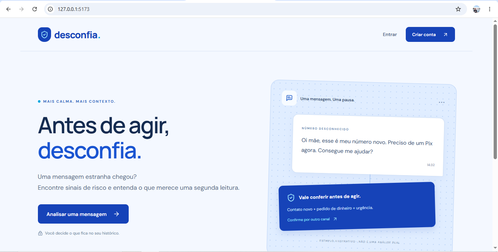 | 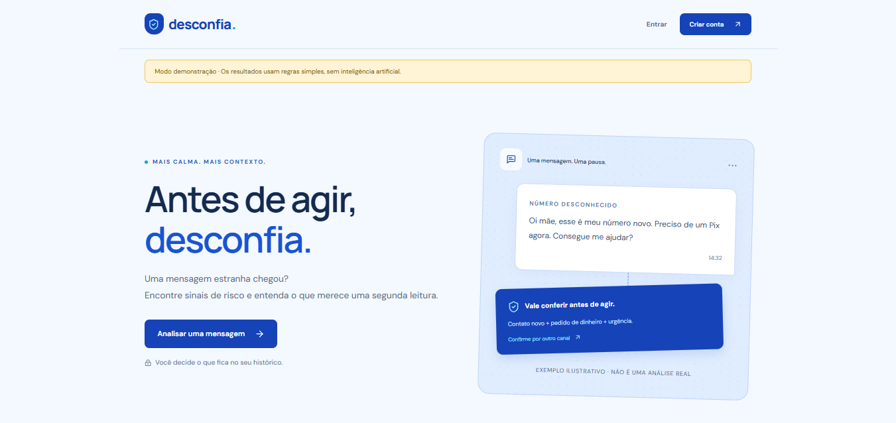 |
| Tela inicial, celular | 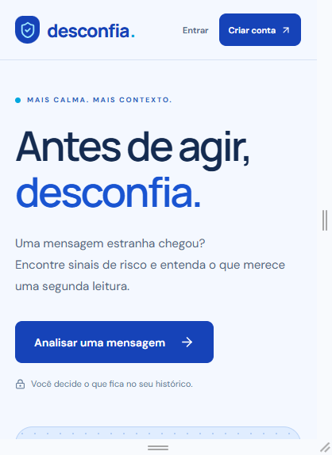 | 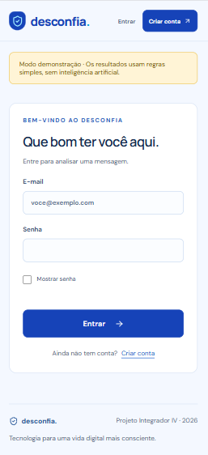 |
| Login e cadastro com validação, computador | balões nativos do navegador (descrição no item 4.5) | 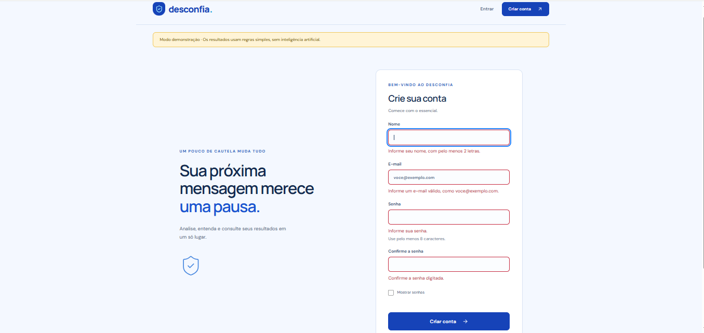 |
| Login e cadastro com validação, celular | balões nativos do navegador (descrição no item 4.5) | 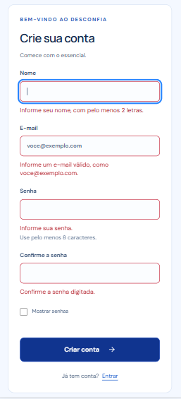 |
| Tela de resultado, computador | 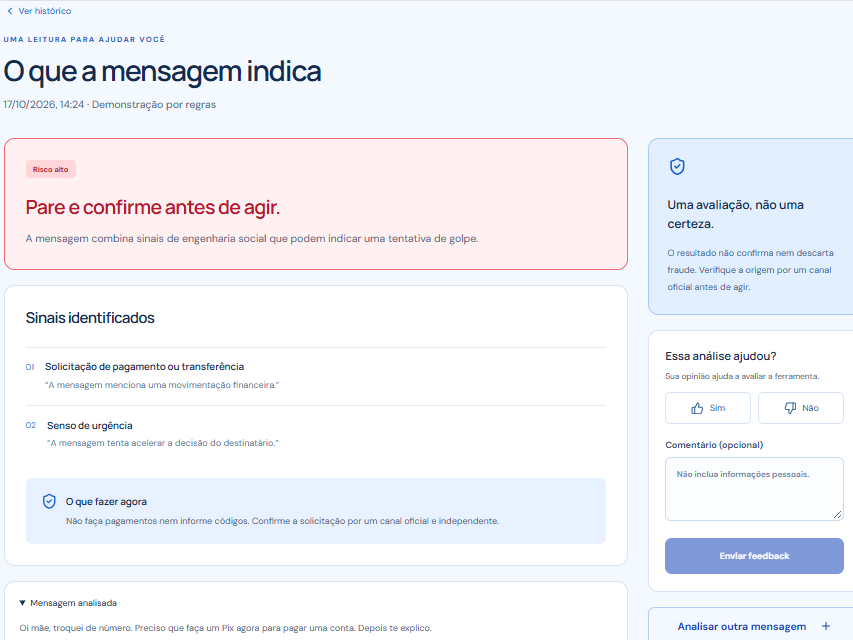 | 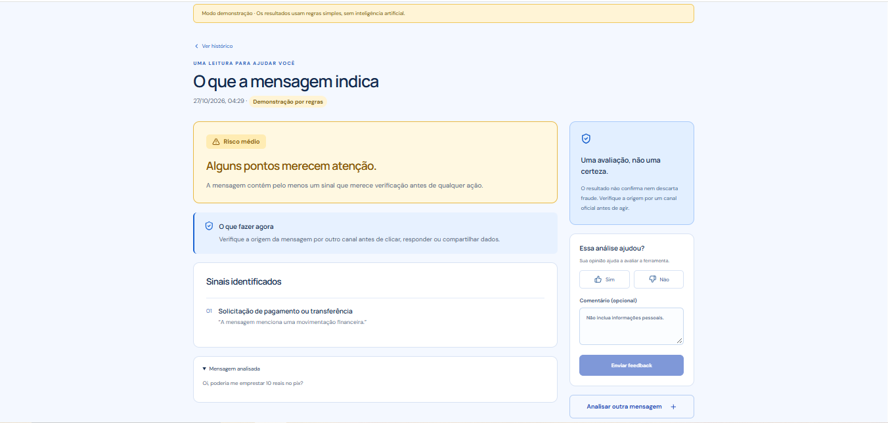 |
| Tela de resultado, celular | 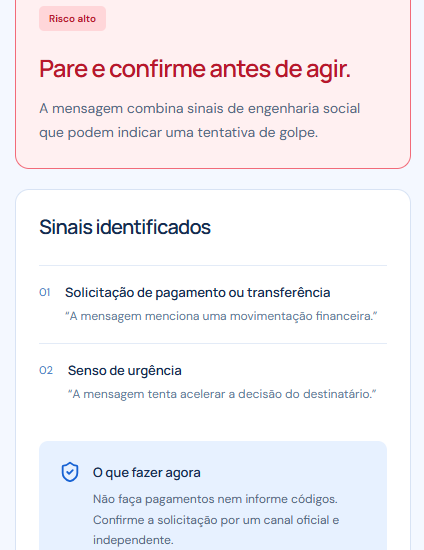 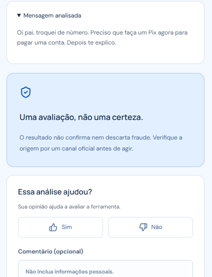 | 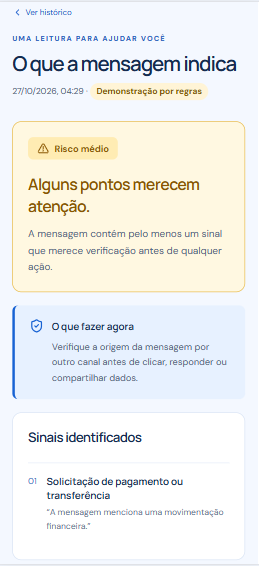 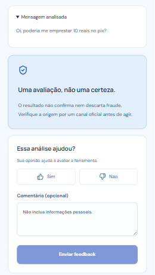 |
| Histórico, computador | 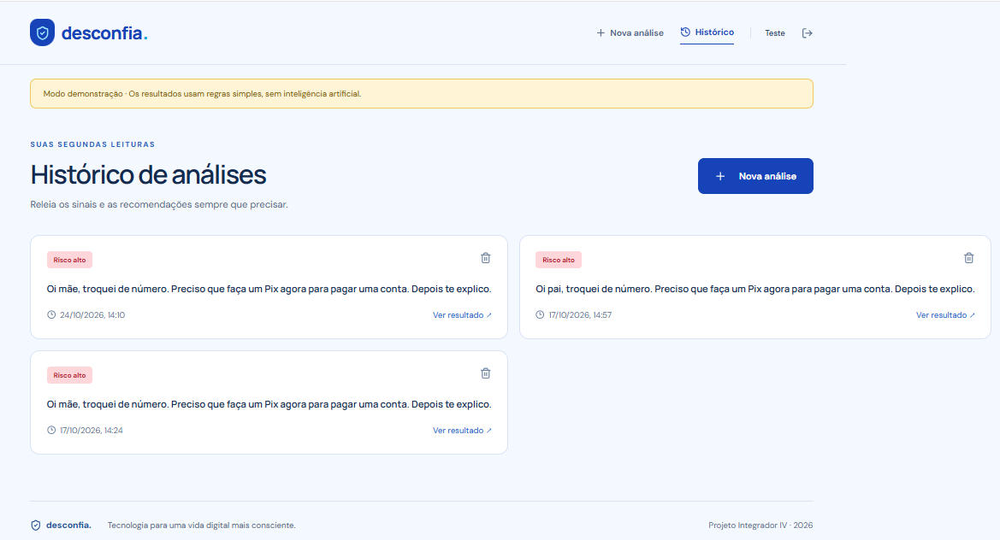 | 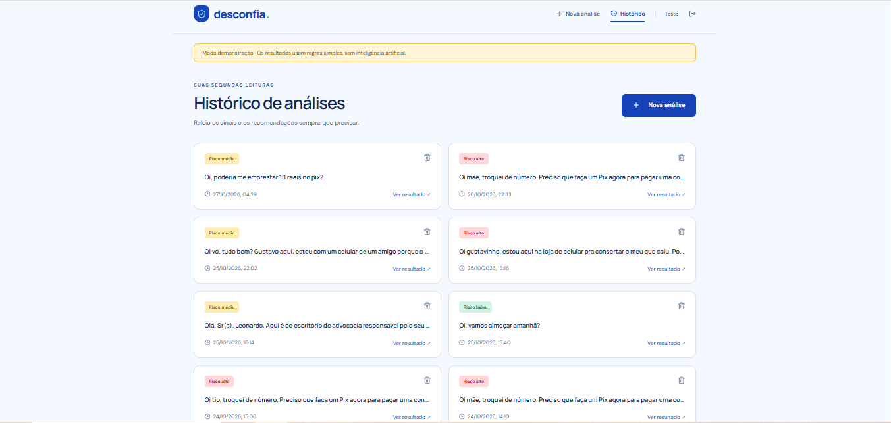 |
| Histórico, celular (cartão cortado) | 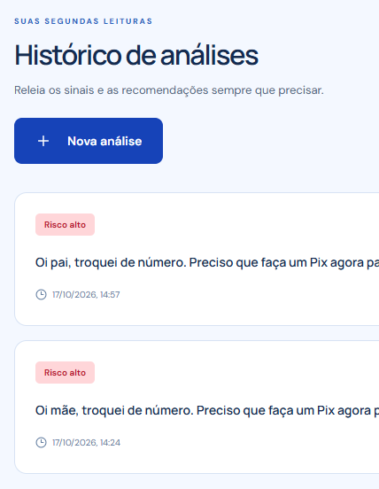 | 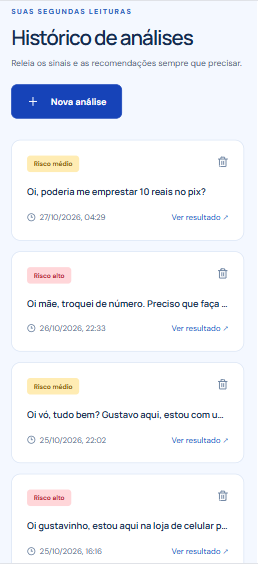 |
| Confirmação de exclusão, computador |  | 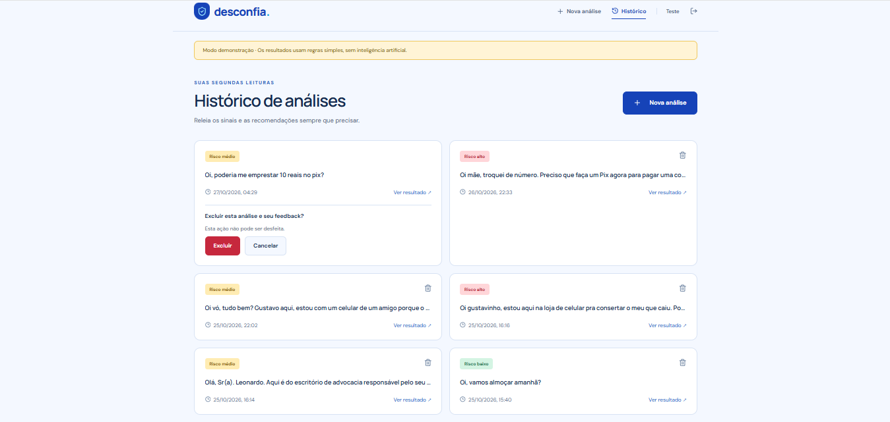 |
| Confirmação de exclusão, celular |  | 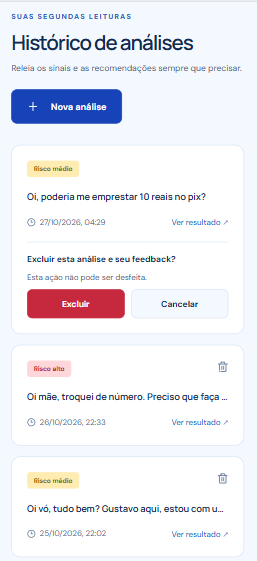 |

## 6. Verificações realizadas

- `pnpm --dir frontend test`:  ✓ src/api.test.js (7 tests) 85ms
 ✓ src/validacao.test.jsx (4 tests) 5178ms
   ✓ Validação dos campos de acesso > mostra mensagens por campo ao tentar entrar sem preencher  1363ms
   ✓ Validação dos campos de acesso > exige senha com pelo menos 8 caracteres no cadastro  1642ms
   ✓ mostra o erro de senhas diferentes abaixo do campo de confirmação  1685ms
   ✓ permite mostrar e ocultar a senha  480ms
 ✓ src/App.test.jsx (5 tests) 10109ms
   ✓ Fluxos do Desconfia > explica o produto e permite acessar cadastro  1147ms
   ✓ Fluxos do Desconfia > impede cadastro quando as senhas são diferentes  1922ms
   ✓ Fluxos do Desconfia > analisa, mostra resultado, envia feedback e faz logout  3704ms
   ✓ Fluxos do Desconfia > mostra carregamento e erro sem inventar resultado  1714ms
   ✓ Fluxos do Desconfia > carrega histórico e exige confirmação para excluir  1609ms

 Test Files  3 passed (3)
      Tests  16 passed (16)
   Start at  04:20:34
   Duration  27.33s (transform 1.36s, setup 13.01s, collect 5.07s, tests 15.37s, environment 23.20s, prepare 4.26s)
- `pnpm --dir frontend build`: $ vite build
vite v7.3.6 building client environment for production...
✓ 1580 modules transformed.
dist/index.html                   0.56 kB │ gzip:  0.37 kB
dist/assets/index-CI6ntFuc.css   16.18 kB │ gzip:  4.41 kB
dist/assets/index-C5I7JsA7.js   245.97 kB │ gzip: 77.10 kB
✓ built in 20.24s
- Lighthouse: ver a tabela do item 3.
- Navegação por teclado e carregamento com rede lenta: ver o item 4.7.
- Teste do fluxo completo pela Hellen (testes): ainda não realizado até 26/10/2026
- Revisão do Pull Request: Yasmin

## 7. Limitações e próximos passos

- O Lighthouse automatizado cobre só parte dos critérios de acessibilidade. Não foi feito teste com leitor de tela (NVDA ou VoiceOver).
- O contraste foi calculado nos pares de cor revisados, não em todos os estados (por exemplo, passar o mouse).
- As mensagens de erro enviadas pelo backend não foram revisadas nesta frente.
- Ainda falta validar as melhorias com participantes da comunidade (estudantes e familiares), conforme os indicadores de compreensão das explicações e clareza das recomendações definidos no C1.
- Possíveis melhorias futuras: link de "pular para o conteúdo", revisão de espaçamentos e testes em mais aparelhos.

## 8. Uso de IA

As alterações foram desenvolvidas com apoio do Claude (Anthropic). O autor aplicou, testou e revisou cada mudança, e os prompts estão registrados em `docs/PROMPTS_INTERFACE.md`.
